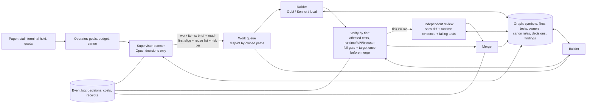

<!-- SPDX-License-Identifier: Apache-2.0 -->
# ADC against the operator's 2026-10-26 concern: assessment and a dynamic-factory proposal

**Status:** proposal for the operator. It changes no code. **Base:** main `0d0bde9e`.
**Evidence:** paths without a prefix are in this repository. **N:** means `/home/mega/nobetci-dev/docs/`. `[INFERENCE]` marks a claim that was not measured.

## 0. Verdict

**The operator is right about ADC.** ADC fixes some of nöbetçi's glue, but it keeps nöbetçi's shape:
- a static per-task pipeline;
- one admitted task at a time;
- an approval bound to every task's spec;
- a fixed check chain that reads the same diff about four times per round and never looks at running behaviour.

ADC is also already **larger than nöbetçi**: about 79.5k lines of non-test Go against nöbetçi's ~46k (N:research/2026-10-26-orchestration-comparison.md:12).

**How we build ADC shows the same disease.** In the last 7 days:
- the lead ran 7 Opus rounds and 4 external rounds on the test driver's shell layer (#440, #441, #443);
- every external reviewer hit a quota at least once;
- a reviewer session was lost in a restart.

**Proposal.** Keep the parts that earned their place: isolation, the gate, the hidden-test overlay, the event log and cost accounting. Replace the task pipeline with:
- a **goal loop** run by a supervisor-planner;
- a **code-and-findings graph** as shared memory;
- **risk-tiered, behaviour-first** verification.

Build it in four slices. Measure each slice by cost and time per accepted outcome.

## 1. Assessment

### 1.1 Where ADC is a static task-list pipeline

| Fact | Evidence |
|---|---|
| One hard-coded 4-node template per task: plan → build → accept → gate. Review is added after the gate. No stage depends on risk, and none can be skipped. | `internal/graph/template.go:37-56`; `internal/authority/admit.go:123-127`; `internal/daemon/reviews.go:5-24` |
| The "plan" is the task's spec, rendered by the controller. No model plans. | `internal/graph/template.go:18-19`; `internal/daemon/plan.go:20-25` |
| The spec is bound once, at `task.create`. No action edits a task, and changing the plan means abandoning the task and creating a new one. | `schemas/vocab/actions.yaml:10-31`; `internal/authority/task.go:15-19,~368` |
| **Abandoning an admitted task needs `actor.revoke` of the approving operator.** No `approval.revoke` exists, and the last live operator cannot be revoked. So with one operator, the stated recovery for the terminal holds ("revoke the task's approval") cannot be done. | `internal/authority/task.go:290-293,385-399`; `internal/authority/cancel.go:5-12`; `schemas/vocab/reasons.yaml:75` |
| One admitted task at a time, FIFO; a held task blocks every other task. | `internal/authority/admit.go:12-14,~52,~72-81`; `docs/design/m1/01-invariant-inventory.md:76` |
| The plan for later milestones keeps the same shape: a fixed logical order; changes are "typed revisions"; "a started task's contract changes only by an approved amend". | `docs/plan/01-first-release-plan.md:352-354,507-508` |
| **Tasks spawning tasks:** in M1 the loop spawns only repair rounds, capped at 5 × 3. The planned supervisor job J3 "turns incidents into tasks for the cycle's own backlog". The P3 "banked as background work" rule is in the plan. | `internal/graph/rails.go:~62`; `docs/plan/02-supervisor-role.md:38`; `docs/plan/01-first-release-plan.md:396` |

### 1.2 Checks: the same artefact several times, behaviour never

**Per round:**
- **The patch is read 4 times:** accept applies it and reads its diff, the gate applies it again, the reviewer reads the diff, and the next builder gets it back as text (`internal/accept/accept.go:141-149`; `internal/daemon/gate.go:150-157`; `internal/review/prompt.go:22-25`; `internal/intent/build.go:111`).
- **The full suite runs twice:** the base is measured again in every gate run, then the candidate is run (`internal/daemon/gate.go:168,185`).

**A red gate still costs an LLM review** before any repair. Repair starts only from a review verdict (`internal/reconcile/reconcile.go:640`; `internal/graph/repair.go:25-27`).

**The reviewer sees the requirement, the diff and the gate's counts, "and nothing else":**
- it has no failing test names, no code around the diff, and no tools;
- it gets one turn;
- accept's "warnings for the reviewer" never reach it, because the review node takes no accept input.

Evidence: `internal/review/prompt.go:22-25`; `internal/intent/review.go:108-125`; `adapters/http-chat/src/adapter.ts:140-141`; `internal/accept/accept.go:12`.

**No running behaviour is checked anywhere:**
- `runtime_verification` is a required profile field that the code only validates;
- the `runtime_verify` node kind is not in M1;
- `integration.plugin` (docker-compose) is schema only;
- there is no HTTP, browser or data probe.

Evidence: `schemas/config/project-profile.json:71-82`; `internal/profile/profile.go:146-149`; `internal/graph/surface.go:16-17`.

**This is nöbetçi's frontend failure, waiting to happen:** "the builder and the reviewer only ever saw jsdom output and code" (N:2026-10-23-frontend-replan.md:9-10).

**Verification does not depend on risk.** Only protected-path blocks depend on paths (`internal/accept/accept.go` `Policy.check`), and there is always one reviewer with the same prompt.

### 1.3 Memory and context

**The builder starts with the brief only** (title + requirement, `internal/brief/brief.go:93-94`):
- a one-sentence system message (`adapter.ts:43`);
- four tools: read, list, write and delete, with **no search, no shell, and no test run** (`adapter.ts:29-33`). So the gate is the builder's first test run.

**A repair builder:**
- starts again from the base (`internal/daemon/run.go:15-16`; `workspace.go:108-110`);
- gets every earlier round's findings as **titles only**, one view per round, never merged (`internal/review/review.go:26-32`; `internal/graph/successor.go:9-12`; `internal/intent/build.go:11-13`).

**Every model turn resends the whole conversation** (`adapter.ts:214,255-261`):
- the gateway's allow-list has no field to request caching (`gateway.ts:27`);
- `PriceMicros` prices cache reads at the full input price, so caching would show no saving (`internal/capacity/ledger/ledger.go:187-189`).

In nöbetçi, cache reads were **94 % of builder cost** (N:research/2026-10-23-builder-cost-analysis.md:44). Its builds made 435 turns on average, and 85–88 % of turns carried one tool call (ibid.:116-120).

**Nothing is remembered across tasks.** There is no symbol index, repo map or findings store (none found under `internal/`, `adapters/` or `cmd/`). The plan excludes one: "No memory service, vector/graph DB, embeddings" (`docs/plan/01-first-release-plan.md:683`; `docs/plan/03-knowledge-layer.md:208-210`). `ContextManifest` is an audit record, never retrieved (`internal/knowledge/manifest.go:15-21`).

**No reuse step exists:** no instruction and no tool to find existing code. In nöbetçi, 32 % of sampled helpers were near-duplicates (N:research/2026-10-22-why-missed.md:28,229).

### 1.4 Where a human or the supervisor must act

**Operator-owned holds:** 10 of the 17 hold kinds have a non-system owner (`schemas/vocab/holds.yaml`). In #400's clearing table (`internal/daemon/holds_table_test.go:39-96`):
- **19 of 26 rows need an operator act** [INFERENCE, classified from the table's text];
- **2 rows are terminal:** `runner: failed`, and `broker_credit_exhausted`.

**Operator-only actions:**
- every task's approval (`task.go:15-19`);
- `task.raise_rail` (`internal/authority/rails.go:103`);
- `actor.revoke`;
- `input.answer`, which an operator or a granted supervisor may do.

**A supervisor's own task can never run:** it gets no approval, and `proposal.confirm` refuses every confirmation (`task.go:18`; `internal/daemon/matrix.go:~62`).

**Review is inactive** until a reviewer route is qualified (P31) (`internal/capability/capability.go:~49-91`).

**Nothing pages anyone.** `graph.Page` is called only from fixtures (`internal/graph/holds.go:142`; `docs/design/m1/01-invariant-inventory.md:284`).

**The lead's own process is supervisor-only, as nöbetçi's is.** Since 10-03:
- 339 PRs merged and 77 closed unmerged;
- 494 review records;
- 203 decision entries in #226;
- 47 of 70 ledger rows still open.

Recent examples:
- #429 took 11 review records;
- #441 was split after 3 external NO-GOs;
- quotas stopped reviewers 4 times in 3 days: Codex credits twice, the Mythos weekly limit, and an Anthropic rate limit; and the lead session was lost once.

### 1.5 nöbetçi failure modes: can they happen in ADC?

| Failure mode (evidence in N:) | In ADC today |
|---|---|
| Tasks generate tasks; the queue outgrows scope (orchestration-comparison.md:33-34) | **Partly closed.** Only bounded repair rounds today, but J3 and P3 banking are planned. **Open** once those land. |
| An install or approval per plan change (ibid.:22-24) | **Open, worse:** no amend at all; only abandon (blocked with one operator) and re-create. |
| Every step for every task (ibid.:25-28) | **Open:** the fixed chain (§1.2). |
| Checks see the diff, not behaviour; the frontend shipped blank (frontend-replan.md:9-10) | **Open:** no runtime, API or browser check (§1.2). |
| No reuse step; plans prescribe duplicates (why-missed.md:229,234) | **Open:** no tool, no instruction (§1.3). |
| P3 as a dead end (why-missed.md:240) | **Planned in** (plan :396). |
| Recurring defect classes, with no memory (why-missed.md:222-225) | **Open:** findings are per round, titles only. No class memory except the lead's hand-kept lessons 1–13. |
| Context resent; one tool per turn (builder-cost-analysis.md:44,120) | **Open:** full resend; no caching; batching of up to 64 calls is allowed. |
| Glue incidents in the framework (orchestration-comparison.md:26-28) | **Open:** 17 hold kinds, 73 reasons and 22 actions. The last week's review effort went into the driver's shell glue. |
| Quota stops with no resume (adc-harvest.md:98-99) | **Partly closed:** `quota_reset` (#433). No cross-provider failover; no paging. |
| A run silently stalled overnight (adc-harvest.md:81-87) | **Partly closed:** `StallOf` shows it on the card, but nothing pages. |

## 2. Target architecture: a goal loop over a shared graph

### 2.1 Goal-driven orchestration

- **The operator approves a goal**, not each task. A goal carries:
  - its acceptance (hidden tests, runtime probes, screenshots);
  - a budget (USD, wall time);
  - its owned paths;
  - its canon.

  This is one authority record and one approval.
- **Inside a goal's grant, the supervisor-planner** may create, amend, split, cancel and reorder work items **without any approval**. Every act is a logged decision (the event log survives). That replaces "approval per spec" (`task.go:15-19`) and the one-admitted-task rule (I22).
- **Work items are small and disposable.** Each carries:
  - a precise brief;
  - a **read-first slice** and a **reuse list** from the graph (N:research/adc-harvest.md:22-34);
  - a risk tier;
  - its owned paths.

  Builders are cheap models. An item that fails twice is re-planned by the supervisor, not retried blindly.
- **Parallel only when disjoint:** the graph's owned-path and symbol edges decide. One merge queue per base.
- **The supervisor runs on a quota budget:** Opus for decisions (planning, risk tiering, triage); bulk reading through cheap read-only scouts (N:research/2026-10-23-astra-builder-context-consult.md:30).

### 2.2 Memory as a graph

- **Nodes:** packages, files, symbols with line ranges, tests, owners/owned paths, canon rules, decisions (#226-style entries), findings, work items, goals.
- **Edges:** `calls`, `defines`, `tests`, `owns`, `violates`, `decided-by`, `same-as`, `fixed-by`.
- **Source:** built at each base commit from `go/packages` (and tree-sitter for TS/Python), from the test inventory, from canon files, and from ADC's own event log. It is stored as projections in adcd's existing store. That is a graph **schema**, not a graph-DB service.

  [INFERENCE: SQLite/bbolt adjacency tables plus recursive queries cover these sizes.]
- **Readers:** the supervisor (plan, impact, disjointness), the builder (tools `find_symbol`, `callers`, `tests_for`, `similar_to`), and the reviewer (context around the diff).
- **Writers:** merges (re-index), reviews and audits (findings), and the supervisor (decisions).
- **Findings are merged, not multiplied.** Each finding has an equivalence key: rule or class, plus symbol or path. A new finding with an existing key attaches to the existing one and raises its count. A finding has an owner and a due point, never "banked". A class seen twice becomes a **guard**: a test or lint (N:research/2026-10-22-why-missed.md:278-279; the lead's lessons 6–13 are this pattern done by hand).

### 2.3 Risk-proportional, behaviour-first verification

| Tier (set by the supervisor from the graph; it can be raised, never lowered by a builder) | Checks |
|---|---|
| **R0**: docs, tests only, non-shipped | accept's guard; affected tests |
| **R1**: normal feature work | the builder runs the affected tests and the **runtime probe** (app started; API probes; Playwright screenshots for UI) inside its own loop; once before merge: the full gate (baseline cached per base commit) plus the target runtime; review is **sampled** or cheap |
| **R2**: authz, security, data paths, protected canon, the framework itself | R1, plus an **independent review** that sees the diff, the code around it, the failing tests, accept's warnings and the runtime evidence |

**Removed outright:**
- a review on a red gate: repair goes straight from the failing tests;
- the base suite re-run on every round;
- repairs that restart from the base.

**Kept outright:** the gate's mechanical verdict, the hidden-test overlay, and the integrity guard.

### 2.4 Autonomy without a babysitter

- **A pager:** Telegram or e-mail, straight from adcd (`graph.Page`, wired). It fires on a terminal hold, on a stall longer than N minutes, on a quota stop, and on a budget at 80 %. Healthy is silent.
- **Quota-aware routing:**
  - a probe per provider and account;
  - failover across **qualified** executors of a role (entry 179's M2 item);
  - ranking by measured cache-aware cost (N:research/adc-harvest.md:51-59);
  - Claude and Codex limits treated as capacity with reset times, not as errors.
- **Prompt caching:** a stable prefix with `cache_control`, cache reads priced at their real rate (fixes `ledger.go:187-189`), and the "tokens resent per byte of new information" metric (adc-harvest.md:10-12).
- **The metric:** cost and elapsed time **per accepted outcome**, accepted meaning merged and its acceptance passing at the target. Supervision minutes per day. Defects found after delivery. The bench record (P25) already holds the inputs (`schemas/records/benchmark-run.json:43,60`).

### 2.5 What survives from nöbetçi and today's ADC

- **Sandbox isolation:** no secrets in the box; the gateway holds credentials (`internal/gateway`).
- **A real gate:** a mechanical verdict from per-test results, plus the hidden acceptance overlay (#429).
- **The target-runtime suite once before merge.**
- **Canon stays operator-only** (protected paths).
- **The tamper-evident event log and its decisions;** the startup replay.
- **Cost accounting** with liabilities.

## 3. Migration path

| Slice | Builds | Deletes or simplifies | Proves |
|---|---|---|---|
| **S0** (now, under 1 day) | Finish checkpoint (a): merge #443 and D2; one live run on #170 as the **baseline** measurement | Stop hardening the bash driver beyond (a); a ledger item moves it to Go if needed (entry 203) | the baseline numbers |
| **S1: context and reuse** | the graph v0 (Go symbols, files, tests, owners) per base commit; builder tools `search`, `find_symbol`, `read_range`, `run_tests` (affected, in the sandbox); a read-first slice and reuse list in the brief; prompt caching; correct cache pricing | the "brief only" builder; repairs from the base (repair on the candidate); titles-only findings (full findings with failing output) | turns per item ↓, tokens resent per new byte ↓, duplicate helpers ↓ |
| **S2: verification by risk** | risk tiers; `runtime_verify` (compose + API probes) and a Playwright lane with screenshots; review inputs widened; the baseline cached per base | review on a red gate; the per-round base re-run; mandatory review for R0/R1 | defects after delivery ↓ (target: no "blank page" class), cost per accepted outcome ↓ |
| **S3: the goal loop** | goal records and grants; a supervisor-planner with create, amend and cancel inside the grant; N concurrent disjoint items; a merged findings ledger with owners and due points | per-task approval; I22 (one admitted task); abandon-by-actor-revoke; P3 banking; J3 "incidents become backlog tasks" | supervision minutes per day ↓, elapsed time per goal ↓ |
| **S4: autonomy** | the pager; quota probes; failover across qualified executors | unused M1 vocabulary (10 of 16 node kinds, merge generations, the phase-gate claim lists) moves to the plan's deferral ledger or is deleted | unattended hours without an operator act |

**Measurement.** Run the same goal (for example #170 plus two InfraMedic frontend screens) under today's pipeline (S0) and after each slice. Record:
- cost per accepted outcome;
- elapsed time per accepted outcome;
- supervision minutes per day (lead plus operator, logged);
- defects found after delivery (a browser/API audit one week later);
- the turns and resend ratio.

**A slice that does not improve its own metric is reverted.**

## 4. Open questions for the operator (each with a recommended answer)

1. **Finish checkpoint (a) on the current pipeline first?** **Yes.** It is close (#443 and D2), and it gives the baseline that every later slice is measured against. Freeze the rest of the M1 plan after it.
2. **Reverse the plan's "no graph DB / no memory" rule** (`03-knowledge-layer.md:208`)? **Yes, narrowly.** A code-and-findings graph built from the repository and the event log is derived data, not agent memory. Keep "no self-editing memory, no embeddings as truth".
3. **Approval unit: goal or task?** **Goal**, with a budget and owned paths. The supervisor acts freely inside it, and every act is logged.
4. **Who is the supervisor-planner?** **Opus**, for decisions only, with a quota budget. Scouts and builders are cheap models. The supervisor is not on the merge path, so its outage stops planning, not running work.
5. **Independent review: when?** **R2 only** (security, authz, data paths, canon, the framework itself), plus random sampling of R1 (for example 1 in 5) to measure the miss rate.
6. **The first target for S2's behaviour checks?** **The InfraMedic frontend** (Playwright and screenshots): the failure is measured there, and it is where the dynamic trial already runs.
7. **Do ADC's own PRs use the new rules (dogfood)?** **Yes, from S1.** Review effort on the lead's PRs scales with the R-tier, and the hand-kept lessons become guards.
